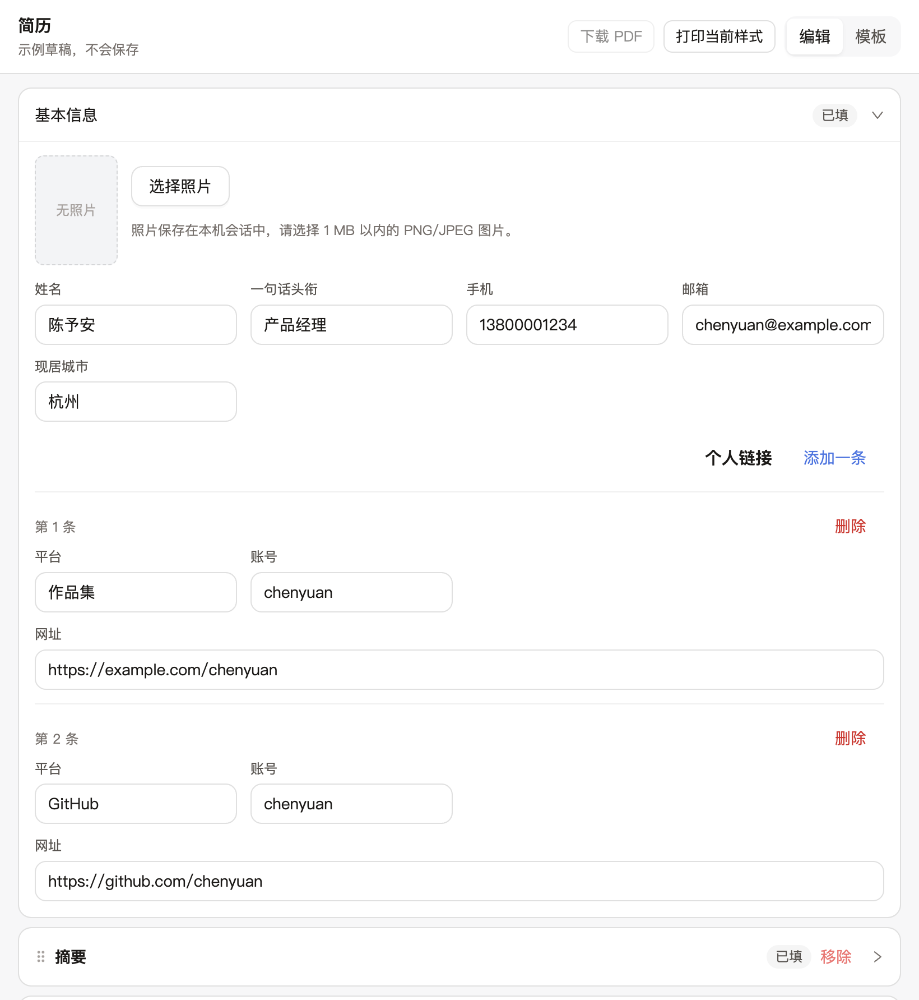
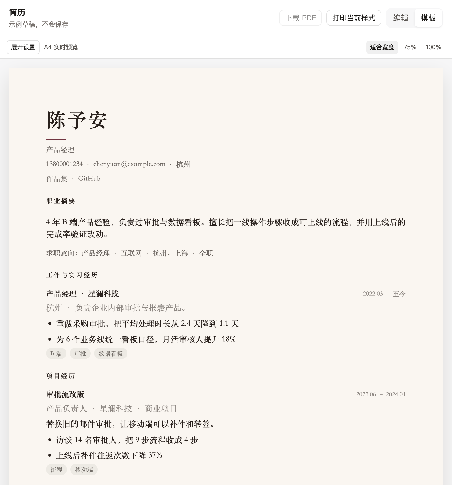
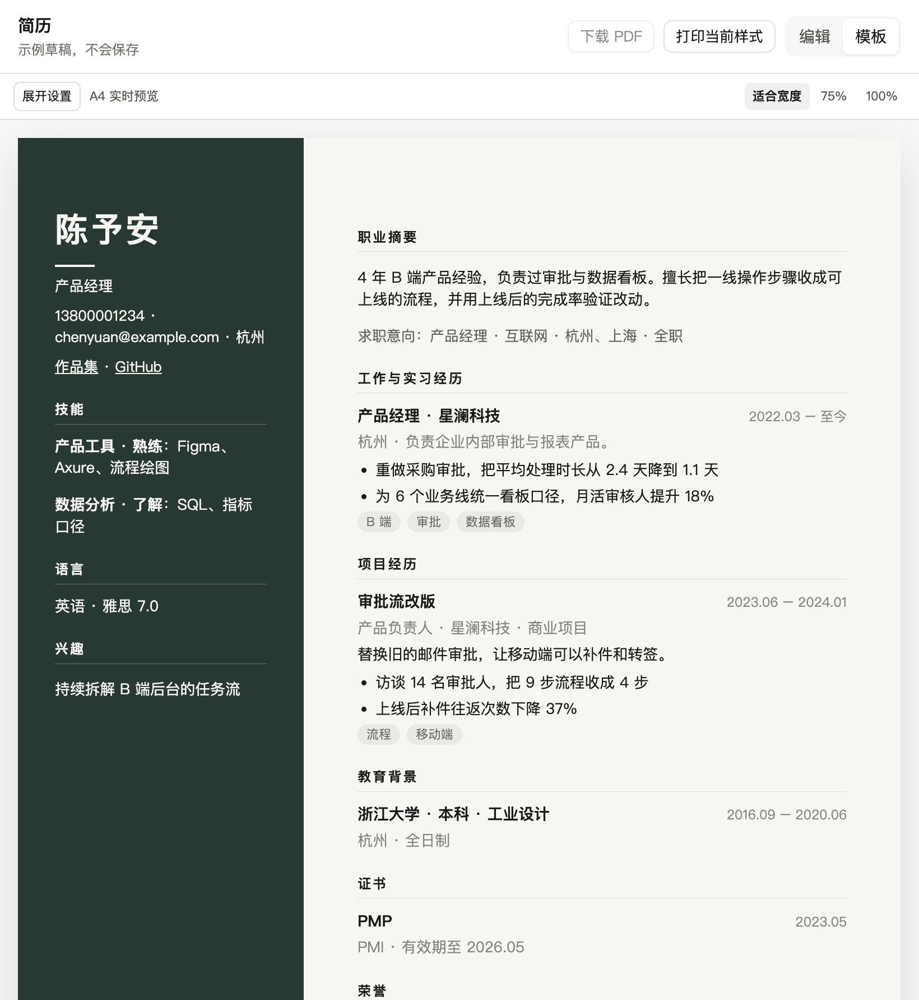
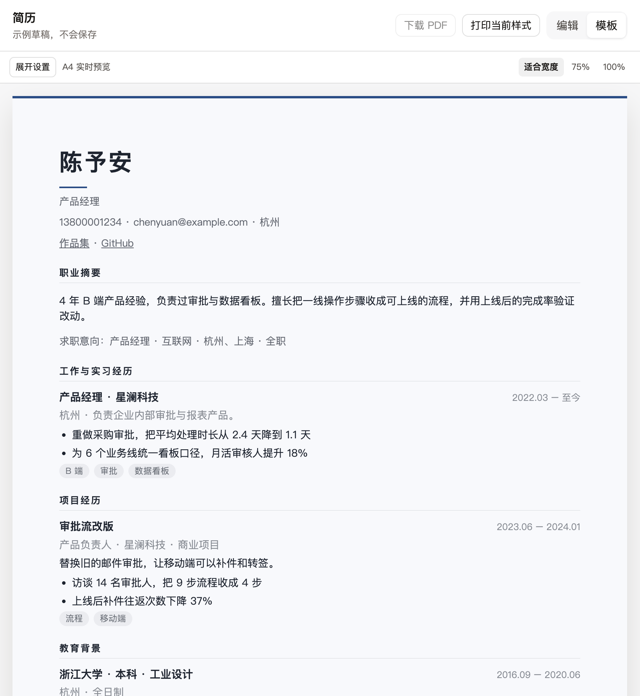

# dsh-hr-plugin

在 DeepSeek Harness 里，一份会话一份简历。对话和右侧面板改的是同一份草稿，可以换模板并下载 PDF。

```sh
dsh plugin --profile web add dsh-hr-plugin
```

装完后重启这个 profile。需要本机已安装 `dsh` 0.2.1-rc.5 到 0.3.0 之前的版本。

## 界面

示例草稿是「陈予安 / 产品经理」。装进会话之后，纸面上是你自己的内容。

<table>
<tr>
<td width="50%">

<br/>编辑页填写基本信息。顶栏可以切到模板。
</td>
<td width="50%">

<br/>杂志：衬线标题，暖色纸。
</td>
</tr>
<tr>
<td width="50%">

<br/>侧栏深色：正文和侧栏分列。
</td>
<td width="50%">

<br/>应届清爽：页顶一条强调色。
</td>
</tr>
</table>

## 使用教程

1. 安装并重启后，打开 Harness。右侧「开始」里点「简历」。
2. 停在编辑页时，可以改基本信息、摘要、工作与实习、项目、教育和技能。其余模块在「添加模块」里打开。模块可以拖动，或用上移、下移调整顺序。
3. 在当前会话里对助手说：把摘要收成三句，并补一条审批时长下降的工作要点。
4. 顶栏切到「模板」，选「侧栏深色」或「杂志」。一共十二套预设，也可以改版式、颜色和字体。
5. 点「下载 PDF」，或对助手说导出 PDF。点「打印当前样式」会走浏览器打印，并保留页面布局。
6. 面板和对话写的是同一份简历。断网时改动留在浏览器里，连上后自动重试；七天内可以恢复。

## 能做的事

- 编辑后自动写入当前会话，页面会读到最新版本。
- 模块顺序会用于页面预览、打印和 PDF。基本信息固定在页眉。
- 十二套预设，以及单栏、教育优先、侧栏三种版式。侧栏版式可以把模块放进正文或侧栏。
- 自定义模块可以是短文本、长文本、日期区间、链接或要点列表。
- 下载 PDF 与「打印当前样式」使用同一份支持中文和自动换页的排版。已启用照片时，PDF 会放入 PNG 或 JPEG。

## 使用前注意

- 安装或更新之后要重启对应的 profile，右侧才会出现「简历」。
- 导出中文 PDF 时，系统里要有支持中文的 TTF 或 OTF 字体。找不到时，用 `DSH_HR_PDF_FONT` 指定字体文件路径。

<details>
<summary>本地开发</summary>

本机调试使用已安装的 `dsh`，不在 `deepseek-harness` 源码目录里安装依赖。日常使用单独的 `hr-dev` profile，不改默认 `web` profile。

全局需要 pnpm 11.7.0。`dsh plugin` 会把参数转发给它。

```sh
corepack enable
corepack prepare pnpm@11.7.0 --activate
```

在本仓库安装开发依赖并编译。`dsh` 加载的是 `dist/index.js`，不直接加载 TypeScript。

```sh
pnpm install
pnpm run build
```

一次性创建调试 profile。这条命令会按网页模板创建 `hr-dev` 并启动；确认页面能打开后停掉进程。

```sh
dsh --profile hr-dev --from-default-profile web
```

在本仓库根目录把它链接进该 profile。因为 `package.json` 声明了 `dsh.bundle`，CLI 会把 `dsh-hr-plugin` 追加进 profile 的 bundle 列表。

```sh
dsh plugin --profile hr-dev add .
```

每次改入口之后：

1. `pnpm run build`
2. `dsh --profile hr-dev --dump-config`。输出里要有 `# == dsh-hr-plugin` 层，以及 `id: hr-plugin`。没有这一层时不要先看业务代码。
3. `dsh --profile hr-dev`。启动日志里要有 `[dsh-hr-plugin] loaded` 和 `resume preview http://127.0.0.1:3091`。

改插件代码必须重新编译再重启。这个加载回路不会热更新。`pnpm run dev:panel` 只预览面板，地址是 `http://127.0.0.1:5174/`，没有会话时使用示例草稿。

面板接口默认只允许本机 Harness（3080）及面板开发服务（5174）的浏览器来源。自定义宿主来源可用逗号分隔的 `DSH_HR_ALLOWED_ORIGINS` 配置。

加载失败时：

- `dsh plugin` 报找不到 pnpm：回到上面的 corepack 步骤。
- 装上了但 `--dump-config` 没有本包的层：`package.json` 里没有 `dsh.bundle`，或 `cordis.patch.yml` 没进 `files`。
- 有层但启动报找不到模块：还没执行 `pnpm run build`，或 `main` 不是 `dist/index.js`。
- 有层、进程起来了，但没有那行日志：`cordis.patch.yml` 的 `name` 不是包名 `dsh-hr-plugin`。

</details>
